<div align="center">

<picture>
  <source media="(prefers-color-scheme: dark)" srcset="docs/media/header-dark.png">
  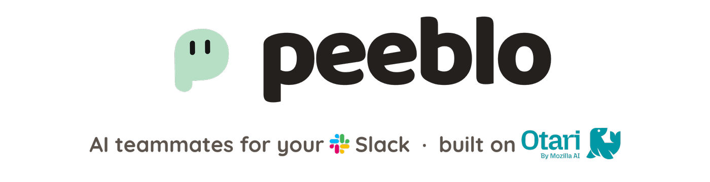
</picture>

**A crew of AI teammates that live in your team's Slack, run on your own machine, and route every call through [Otari](https://otari.ai).**

[](https://github.com/hitakshiA/peeblo/actions/workflows/ci.yml)
[](LICENSE)
[](docs/OTARI.md)
[](#open-weight-models-one-per-role)
[](docs/SETUP.md)
[](tsconfig.json)

[Demo](#watch) · [How it works](#how-a-message-becomes-work) · [Otari inside](#built-on-otari) · [The harness](#the-harness) · [Run it](#run-it) · [Docs](#read-more) · [peeblo.xyz](https://peeblo.xyz)


</div>

---

## At a glance

<table>
<tr>
<td width="50%" valign="top">

### <a id="watch"></a>▶ The demo

<a href="https://www.youtube.com/watch?v=WBk62D_QkYQ">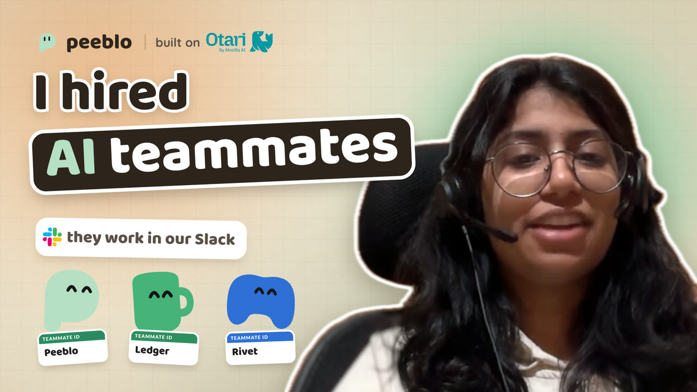</a>

A real Slack company, real teammates, real Otari: hiring, an incident, a bug fix, budgets and a make-good.

</td>
<td width="50%" valign="top">

### ▶ Building on Otari: feedback

<a href="https://www.youtube.com/watch?v=-bHsLXCcfUE">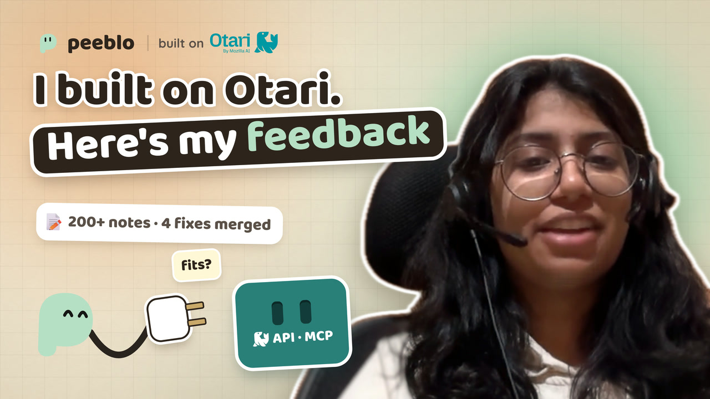</a>

What worked, what we'd add, and the fixes we sent upstream.<br>
📄 [Read the written feedback](https://docs.google.com/document/d/15EANmt49EhVH9HPJUV121e9xmLIztXdngivCmpCgIjo/edit)

</td>
</tr>
</table>

| | |
|---|---|
| **Otari comes in** | [`0661c65`](https://github.com/hitakshiA/peeblo/commit/0661c6554033ebe64e6ffa0500fd0ace18a3b55f): every model call, tool, budget and guardrail through hosted Otari |
| **Contributions to Otari** | Merged: [#2906](https://github.com/mozilla-ai/otari/pull/2906) guardrail log leak · [#2952](https://github.com/mozilla-ai/otari/pull/2952) usage across tool-loop rounds · [#2963](https://github.com/mozilla-ai/otari/pull/2963) tool calls cut mid-write · [#2966](https://github.com/mozilla-ai/otari/pull/2966) guardrails fail closed<br>Open: [#2967](https://github.com/mozilla-ai/otari/pull/2967) · [#3080](https://github.com/mozilla-ai/otari/pull/3080) · [#3102](https://github.com/mozilla-ai/otari/pull/3102) · [#3103](https://github.com/mozilla-ai/otari/pull/3103) · issue [#3079](https://github.com/mozilla-ai/otari/issues/3079) |
| **Open-weight models** | DeepSeek V4.1 Flash, MiniMax M3.1 Flash, Kimi K3.1 Pro, Nemotron 3.5 Super VL, Qwen3 (guard, vision fallback, embeddings, rerank), FLUX.1 schnell, each in its own role ([below](#open-weight-models-one-per-role)) |
| **Otari, end to end** | Routing policies · fallbacks · budget step-down · router · keys and spend ceilings · per-person budgets · end users · guardrails · rule checks · MCP connectors and grants · search · fetch · code sandbox · files · images · batches · embeddings · rerank · decisions · usage, sessions and traces |

<p align="center">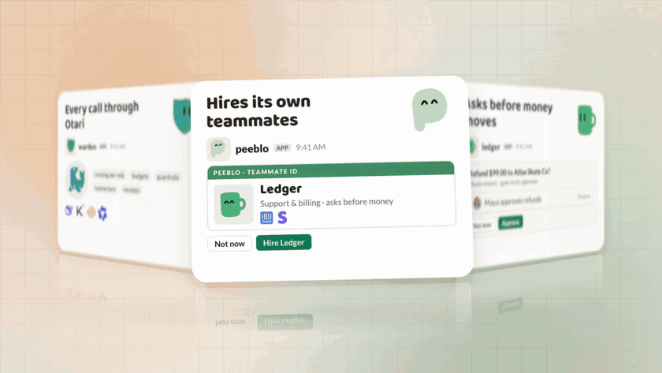</p>

---

## Contents

- [What it is](#what-it-is)
- [How a message becomes work](#how-a-message-becomes-work)
- [Built on Otari](#built-on-otari)
  - [The relay: the model never holds a key](#the-relay-the-model-never-holds-a-key)
  - [One wallet, enforced in layers](#one-wallet-enforced-in-layers)
  - [Routing per role](#routing-per-role)
  - [Open-weight models, one per role](#open-weight-models-one-per-role)
  - [A model per job, helpers for the hard part](#a-model-per-job-helpers-for-the-hard-part)
  - [Screening what comes from outside](#screening-what-comes-from-outside)
  - [Connectors, read-only held twice](#connectors-read-only-held-twice)
  - [The toolbox](#the-toolbox)
  - [Receipts, sessions and traces](#receipts-sessions-and-traces)
  - [One sign-in sets up Otari](#one-sign-in-sets-up-otari)
- [The harness](#the-harness)
  - [The crew and hiring](#the-crew-and-hiring)
  - [Approvals and authority](#approvals-and-authority)
  - [The reviewer](#the-reviewer)
  - [Memory](#memory)
  - [Routines and triggers](#routines-and-triggers)
  - [A computer for each teammate](#a-computer-for-each-teammate)
  - [Shipping code without a key](#shipping-code-without-a-key)
  - [Teammates working together](#teammates-working-together)
  - [Durable by design](#durable-by-design)
  - [Security posture](#security-posture)
- [Run it](#run-it)
- [Quality](#quality)
- [Read more](#read-more)

---

## What it is

Peeblo is a crew of AI teammates in Slack. Each one is hired like a person.

- **A name, a face and its own Slack app.** You DM it or tag it like anyone else.
- **A job, a budget and only the tools you give it.** Read-only where you say so.
- **Its own Linux computer** for code, files, data and a browser.
- **It asks first.** Money, deletes and shipping go to the person who approves them.
- **It signs every reply** with what it cost and which model served it.
- **Peeblo, the chief of staff,** helps everyone, keeps company memory, and hires new teammates when you say yes.

It runs on your machine. Every model call, tool, connector, budget and guardrail goes through Otari, on open-weight models.

<picture>
  <source media="(prefers-color-scheme: dark)" srcset="docs/media/architecture-dark.png">
  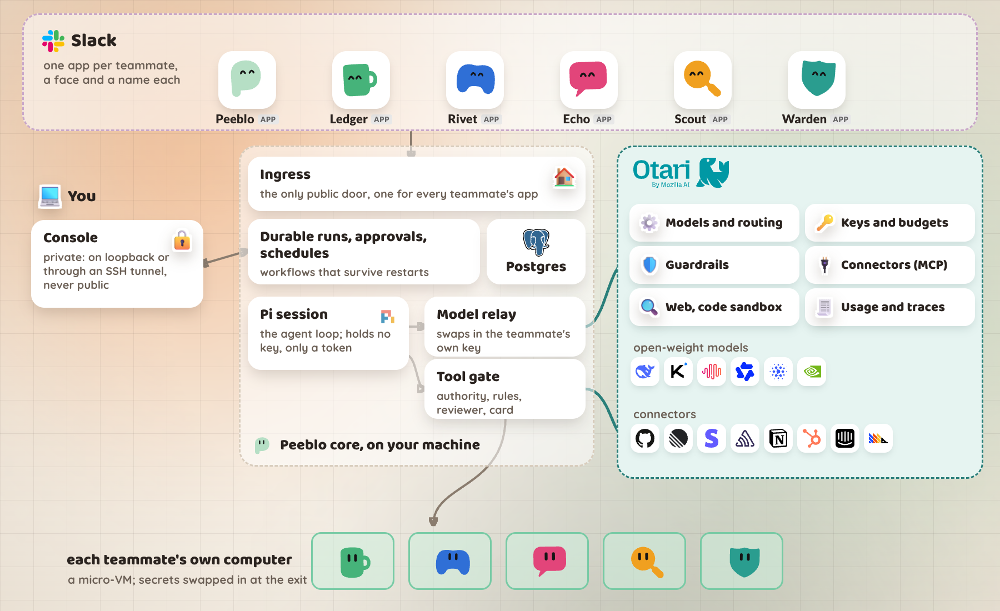
</picture>

---

## How a message becomes work

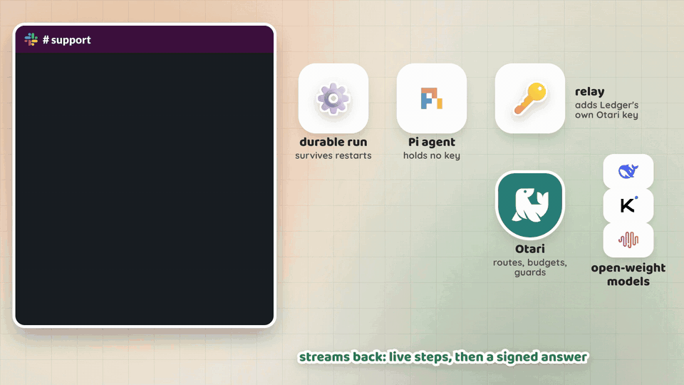

1. **Slack → a durable run.** One public endpoint takes every app's events. Each message becomes a submission that can't run twice, and a run that survives restarts.
2. **A session per conversation.** Each Slack thread maps to its own agent session (Pi), with a fixed tool list and a stable prompt prefix, so the provider's cache stays warm.
3. **Tools through a gate.** Every tool call is checked for authority, rules and risk before it runs, and a person is asked when it matters.
4. **Models through a relay.** Model calls leave through a loopback relay that adds the real key, the person and the conversation, then goes to Otari.
5. **Shown as it works.** Slack shows live steps while it runs. The answer arrives in the thread, signed with a receipt drawn from the event log, not written by the model.

---

## Built on Otari

Peeblo holds no provider keys. It holds one Otari service key, a sealed admin session when someone connects, and one Otari key per teammate. Otari is where the money, routing, safety and tools live.

<p align="center">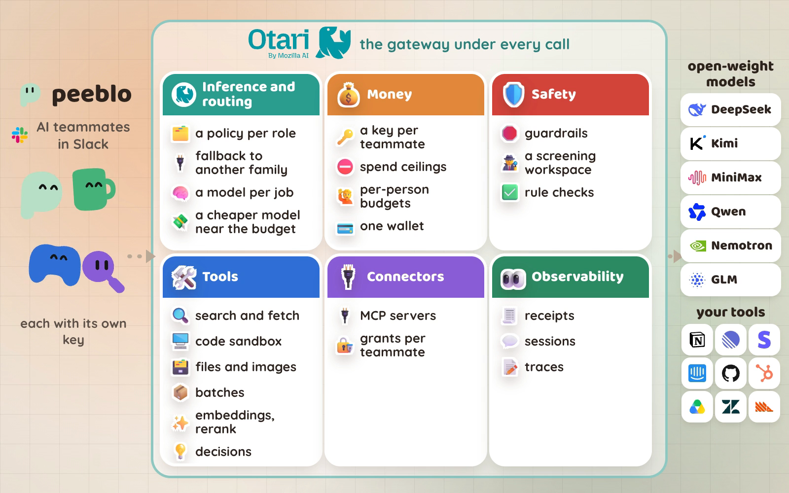</p>

### The relay: the model never holds a key

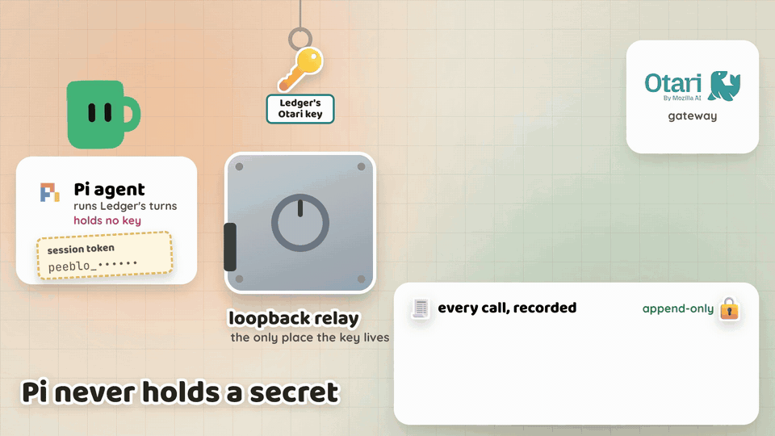

- **Pi gets a session token, not a key.** The token only works on a loopback relay inside Peeblo.
- **The relay signs each call** with the teammate's own Otari key, the Slack person as the end user, and the thread as one Otari conversation.
- **Every attempt is recorded** from Otari's response: request id, provider, served model, fallback, guardrail verdict and cost, into an append-only event log.
- **A call cut off by a crash is settled later** against Otari's usage record, so nothing is lost or billed twice.

### One wallet, enforced in layers

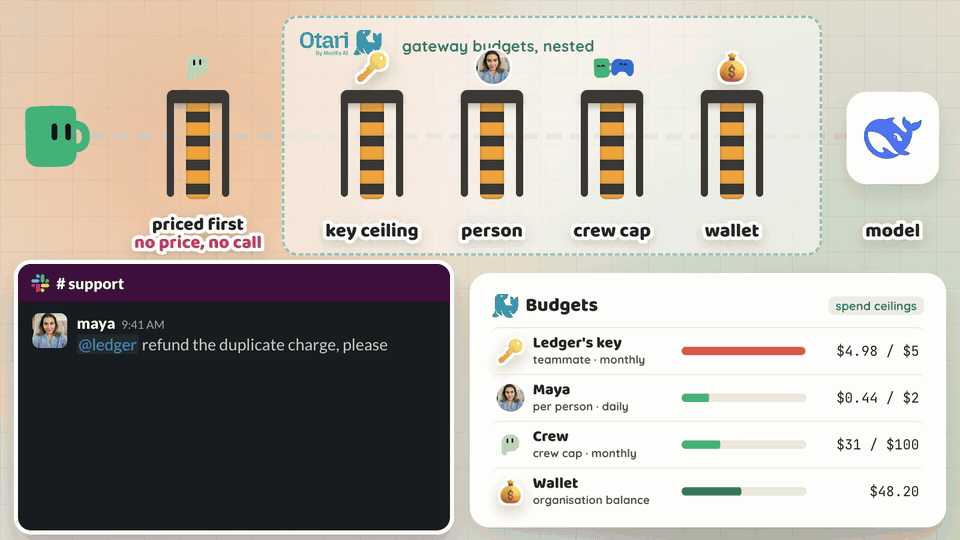

- **A key per teammate** with its own spending ceiling, model allow-list and tool allow-list. Pausing a teammate switches its key off; firing removes it.
- **A budget per person** on every key, so a person keeps their tier across the whole crew.
- **A cap on the whole crew** and the org wallet on top.
- **Priced before it leaves.** Peeblo prices each call from Otari's catalog. No price, no call.
- **Then Otari enforces it again**, at the key, the person, the crew and the wallet. A refusal turns into one plain sentence for the person.
- **Raise in one click.** The owner gets a Raise button on the card; the ceiling moves in Otari and the stopped job runs again.

### Routing per role

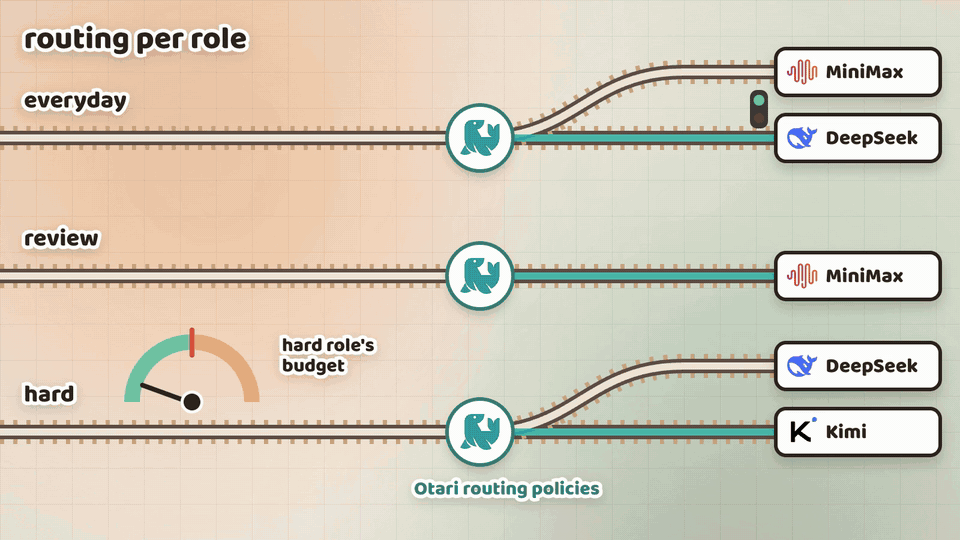

- **Each kind of work is a role**, and each role is its own routing policy in Otari.
- **Fallback across families.** When a provider fails, the policy falls back to a model from another family, so one outage never stops the crew.
- **Budget step-down.** The heavy role moves to a cheaper model once a teammate has used most of its budget, judged against that teammate's own ceiling.
- **Explained before it changes.** A routing change asked for in Slack is checked with Otari's explain first, and a draft that can't serve is refused with Otari's own reason.
- **Your dashboard edits stay.** Peeblo only re-pushes the roles it changed.

### Open-weight models, one per role

| Role | Model | Why |
|---|---|---|
| Everyday work, Peeblo itself | DeepSeek V4.1 Flash | strong, fast and cheap with cached prompts |
| Reviewer, judge, grader | MiniMax M3.1 Flash | a different family from the worker, so they don't share blind spots |
| The hard part of a job | Kimi K3.1 Pro | the strongest open model, chosen by Otari's router, stepping down on budget |
| Looking at screenshots | Nemotron 3.5 Super VL | vision, with a Qwen3 VL fallback |
| Screening | Qwen3 Guard | confirms each guardrail flag, piece by piece |
| Memory search | Qwen3 embeddings + rerank | recall across notes and past work |
| Pictures | FLUX.1 schnell | Apache-2.0 |

### A model per job, helpers for the hard part

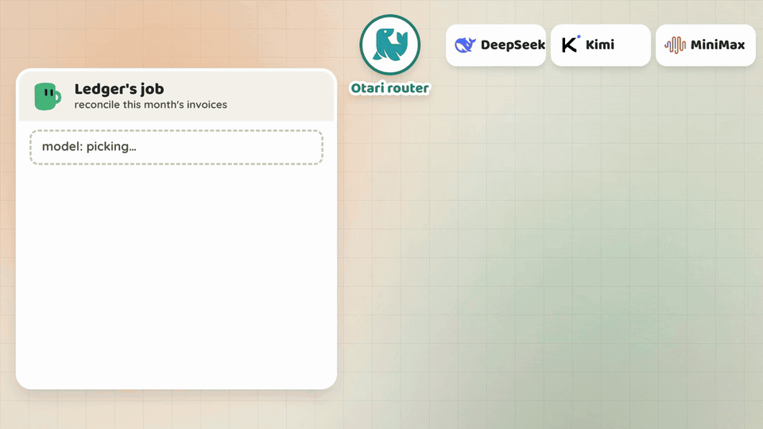

- **Picked once, at the start.** Otari's router chooses the everyday or the strong model when a job begins, and the job keeps it, so the prompt cache survives.
- **Hard parts go to a helper.** A teammate can ask the router which model fits one hard piece, see a price card when it's costly, and run that piece as a helper on the pick.
- **Sent back, moved up.** If the final check finds the job unfinished, it moves to the strong model.

### Screening what comes from outside


- **Only outside text is screened:** web pages, shared files, connector results from support inboxes and the open web. The teammate's own prompts never go through it.
- **A workspace of its own.** Lakera runs in Otari on a separate screening workspace, so it never trips on the agent's instructions.
- **Confirmed piece by piece.** An open guard model checks every flag over overlapping pieces, so a short attack hidden in a long page can't pass as safe.
- **Only the bad item is held back.** In a list of search hits or tickets, the flagged item is replaced and the rest goes on.
- **Wrapped, not trusted.** What passes reaches the model marked as untrusted, and notes written after reading it wait for the owner to verify them.

### Connectors, read-only held twice


- **Every connector is an MCP server in Otari.** Peeblo lists tools on the teammate's own key, so each teammate sees only what it may use.
- **Read-only is held twice.** Peeblo refuses the write, and Otari refuses it too: writers get their own grant per key, read-only teammates fall back to read tools.
- **Pinned to what it read.** Each call names the server revision its tool list came from.
- **A fixed tool list.** Teammates find connector tools by search instead of loading them all, which keeps the prompt small and the cache warm.

### The toolbox

<p align="center">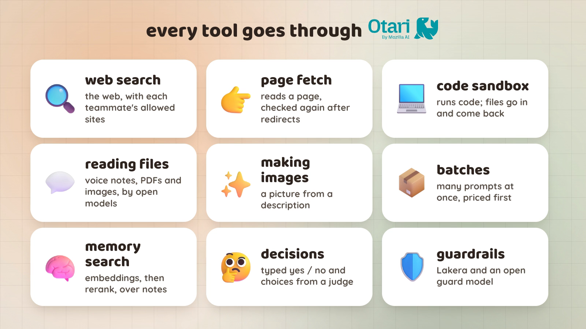</p>

Web search and page fetch, a code sandbox with files in and out, reading voice notes, PDFs and images by the best open model for each, pictures, batches for bulk work, memory search with embeddings and rerank, and typed decisions. Each is chosen by the teammate, priced, and carried on its own key.

### Receipts, sessions and traces


- **Every reply is signed:** which models served, what it cost, any fallback, which guard checked, which connectors it used.
- **A Slack thread is one Otari session**, named after the teammate, the place and the first ask.
- **One click to the trace.** The receipt links to each request and to the whole session in Otari, which admins can share, open under break-glass, or clear.

### One sign-in sets up Otari

Paste a service key, sign in to Otari once, and Peeblo sets the rest: a budget per person, the role routing policies, a key and ceiling per teammate, connector grants, and the screening workspace. The console's checklist shows what's ready and links to the exact page for anything left.

---

## The harness

### The crew and hiring

- **Ask Peeblo for a teammate.** It drafts one and shows you its ID card: the job, the tools, the budget and what it asks first.
- **Hired on your yes.** The new teammate gets its own Slack app, its own Otari key with a ceiling, and only the tools you picked.
- **Changed by talking.** "Give Beacon Linear too, read only" updates it; a model change keeps a fallback from another family.
- **Skills, not scripts.** How teammates hire, reconcile numbers, handle approvals, write recipes and decide when to speak lives in [`skills/`](skills).

### Approvals and authority


- **Every tool call passes a gate:** authority, rules, the reviewer, and a card when it matters.
- **The right person decides.** Money goes to the person who approves money, a merge to the engineer, a customer email to the account owner, from an approvals note in company memory.
- **Some things always ask:** money, deletes, shipping and posts outside the thread, in every mode but one you turn on yourself.
- **Approve once, run once.** An approval is its own durable workflow, so after a restart the same call joins the same card.

### The reviewer

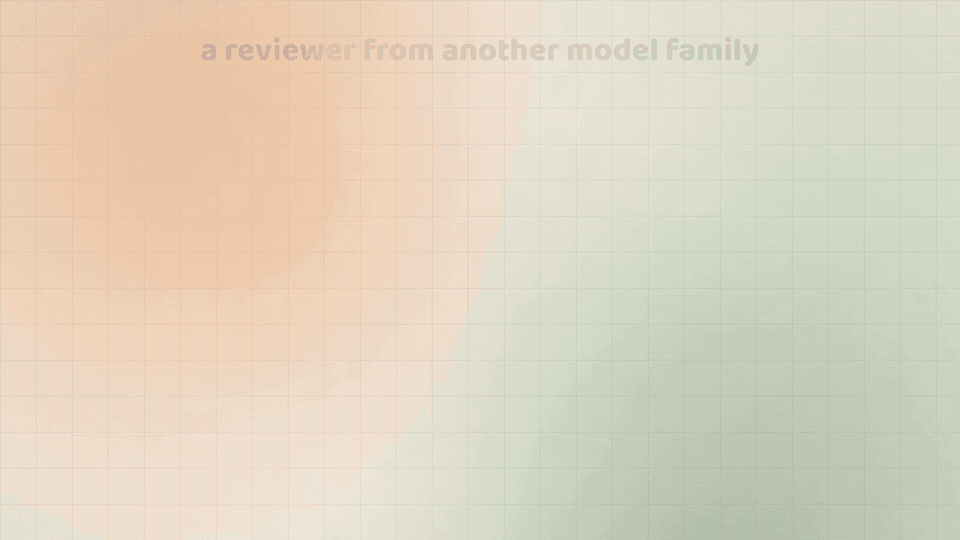

- **A second model family checks the first.** The reviewer sees only what the person asked and the action about to happen, never the tool output that could steer it.
- **Typed, not chatty.** It answers in a strict shape: allow or block, then allow, revise or ask a person.
- **A stored routine is never consent.** Scheduled work is judged against the words of the person who set it up.

### Memory

- **Notes are versioned files**, one history per teammate, written only by Peeblo.
- **Scoped by place.** What you say in a DM stays in that DM; a channel's notes stay in the channel; company memory is shared and changes only with an admin's yes.
- **Outside content is quarantined.** Notes written after reading untrusted text wait for the owner to verify them.
- **Work leaves a trail.** Every finished job writes a summary, so a later conversation can find what was done.
- **Recall searches meaning,** with keyword and vector candidates reranked by Otari.

### Routines and triggers

- **Teammates set their own routines:** "every Monday at 9", "remind me at 6", "when a dispute comes in".
- **In your time zone**, daylight saving included.
- **Webhooks and watches.** Signed webhooks from services, or a watch that wakes only when a result changes.
- **Quiet by default.** A routine first decides whether anything is worth reporting, runs on its own budget, and its approvals wait for the owner.

### A computer for each teammate

- **Its own Linux micro-VM,** booted on the first command and asleep when idle.
- **Layered disks:** a pinned base, a recipe disk built once and verified, a working disk, and a workspace that never resets.
- **Secrets never enter the VM.** It sees placeholders; the real value is swapped in at the network exit, only for that secret's hosts.
- **Every command is a job** with its output in files, so long builds and tests run in the background for hours.
- **Rule checks on every command**, evaluated by Otari.

### Shipping code without a key

- **The VM never holds a write credential.** Work leaves as a git bundle and is checked on the host: its own branch, fast-forward only.
- **Pushed from a mirror** the agent can't write, with the token held on the host.
- **The repo's own guardrails decide.** Rules are read from the base commit, so a branch can't loosen its own rules, and Otari checks them before any push.
- **A person approves the push.** Then a branch or a draft pull request.

### Teammates working together

- **Hand-offs in the open.** One teammate @mentions another in the thread; it joins with its own app and posts its own result and receipt there.
- **Billed to the person who asked**, with limits on depth and spend.
- **Helpers in parallel** take side work on their own sessions and hand back what they found.

### Durable by design

- **Every run is a durable workflow** keyed by its run id. After a restart, the turn resumes on the same session, and the agent is told it's resuming.
- **Writes don't repeat.** A tool call that already finished returns its result instead of running again.
- **Waiting wakes on events,** not polls: a helper's or teammate's result arrives when its workflow ends.

### Security posture

- **The model never sees a secret.** Not the Otari key, not a connector token, not a repo credential.
- **The console is never public.** It listens on loopback, reached through an SSH tunnel on a server.
- **One public endpoint**, signature-checked, for every Slack app.
- **Untrusted text is marked, screened and fenced** from memory and from writes.
- **Read-only and open-weight-only are enforced twice**, by Peeblo and by Otari.

---

## Run it

On a Mac with Apple silicon, or a Linux server with KVM:

```sh
./peeblo up       # Postgres, core, the teammate computers, the console
```

Open `http://127.0.0.1:7340/console/` and follow the setup: your Otari key, one Otari sign-in, a public address, Slack. Everything after `up` happens in the browser.

- `./peeblo check` tests every part, Otari included, and says how to fix what isn't ready.
- `./peeblo backup` saves the database and memory. `./peeblo upgrade` waits until no job is running.

The full guide, with the server's network: [docs/SETUP.md](docs/SETUP.md).

---

## Quality

- **Strict TypeScript**, formatted and linted with Biome, unused code caught by knip.
- **Unit and integration tests** against a real Postgres, run in CI with actions pinned by commit.
- **Security checks** in CI, dependency updates by Dependabot.
- **Evaluated on real tasks:** tool choice, computer choice, skills, when to speak, the reviewer policy and the guard.
- **Checked live:** `./peeblo check` proves each Otari part works, including a real attack that must be refused and a force push that must be stopped.

---

## Read more

| | |
|---|---|
| [docs/SETUP.md](docs/SETUP.md) | from a fresh machine to a teammate in Slack |
| [docs/ARCHITECTURE.md](docs/ARCHITECTURE.md) | how a message becomes a run, and where each rule is enforced |
| [docs/OTARI.md](docs/OTARI.md) | how Peeblo uses Otari, and the choices behind it |
| [docs/CONFIGURATION.md](docs/CONFIGURATION.md) | every setting, with its default |
| [skills/](skills) | how teammates hire, approve, reconcile and decide when to speak |
| [CONTRIBUTING.md](CONTRIBUTING.md) | a dev copy, where things live, a good pull request |
| [SECURITY.md](SECURITY.md) | report a vulnerability privately |
| [site/](site) | the landing page at [peeblo.xyz](https://peeblo.xyz) |

<p align="center"><sub>Apache-2.0 · made by <a href="https://github.com/hitakshiA">Hitakshi Arora</a></sub></p>
